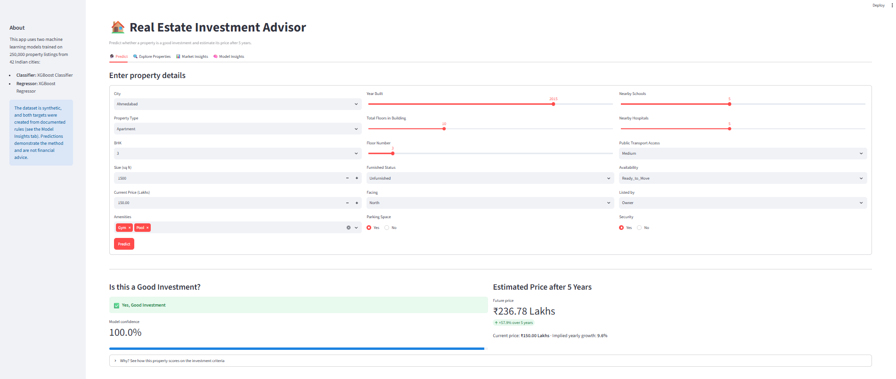
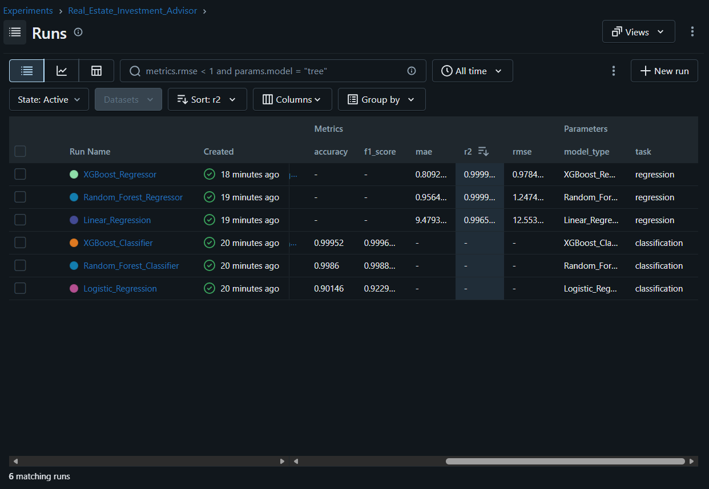
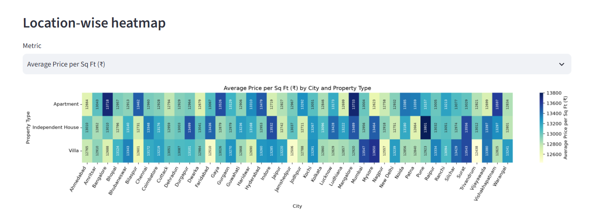

# 🏠 Real Estate Investment Advisor

**Predicting property profitability and future value with machine learning**

🔗 **Live app:** [real-estate-advisor-stuti.streamlit.app](https://real-estate-advisor-stuti.streamlit.app/)
*(Free Streamlit apps sleep when unused. If you see "This app has gone to sleep", click the button to wake it up; it takes a minute or two.)*



---

## Overview

Buying property is one of the largest financial decisions people make. This project builds a tool that helps investors answer two questions about any property:

1. **Is this a good investment?** (classification)
2. **What will it be worth in 5 years?** (regression)

The models are trained on 250,000 property listings from 42 Indian cities, tracked with **MLflow**, and served through an interactive **Streamlit** app.

## Results

| Task | Best model | Metrics (test set of 50,000 properties) |
|---|---|---|
| Good Investment (classification) | XGBoost | Accuracy **99.95%**, F1-score **0.9996** (24 errors out of 50,000) |
| Future Price after 5 years (regression) | XGBoost | RMSE **0.98 lakhs**, MAE **0.81 lakhs**, R² **0.99998** |

All six models compared:

| Classifier | Accuracy | F1 | | Regressor | RMSE | R² |
|---|---|---|---|---|---|---|
| Logistic Regression | 0.9015 | 0.9230 | | Linear Regression | 12.55 | 0.99654 |
| Random Forest | 0.9986 | 0.9989 | | Random Forest | 1.25 | 0.99997 |
| **XGBoost** | **0.9995** | **0.9996** | | **XGBoost** | **0.98** | **0.99998** |

> **Note on the high scores:** EDA showed the dataset is synthetic, with features generated independently of price. Both targets were therefore created from documented, domain-based rules (see Methodology), and the models learn those rules almost perfectly. The scores show the pipeline works as designed, not real-world market accuracy.

## Methodology

**1. Data preprocessing** (`notebooks/preprocessing.ipynb`)
- No missing values or duplicates were found.
- `Price_per_SqFt` was recalculated in rupees (it was stored in lakhs and rounded).
- `Floor_No` exceeded `Total_Floors` in 116,304 rows (47%); values were capped and the rows flagged.
- New features: amenity count and one column per amenity, school density score, and an infrastructure score.
- Scaling and one-hot encoding are done inside the model pipelines, fitted on training data only to avoid data leakage.

**2. Target creation**
- **Future Price (5 years)** = Current Price × (1 + r)⁵, where the yearly growth rate *r* starts at 8% and is adjusted for public transport access (±1%), property age (±1%), 4+ amenities (+0.5%) and security (+0.5%), giving 6–11%.
- **Good Investment** = a multi-factor score with one point each for: price per sq ft at or below the city median, 3+ BHK, ready to move, Medium/High transport access, and 5+ nearby schools. A score of 3 or more out of 5 is labelled Good (64% of properties).

**3. Exploratory data analysis** (`notebooks/exploratory_data_analysis.ipynb`)
All 20 questions from the brief are answered with charts, covering price and size, location, feature correlations, and investment and amenities.

**4. Model training and tracking** (`train.py`)
Three classifiers and three regressors were trained with an 80/20 split. Every run's parameters, metrics, charts and model were logged to MLflow, and the best model for each task was registered in the MLflow Model Registry.



## Key Findings

- **Prices and sizes are uniformly distributed** and unrelated (correlation −0.003).
- **Location has almost no effect:** average prices differ by only 2.5% across states and 3.1% across cities.
- **Property features do not drive price:** property type, BHK, furnishing, facing, parking, amenities, schools and hospitals all show near-zero relationships with price.
- **Strong correlations exist only between calculated columns**, such as price and price per sq ft.
- **Feature importance matches the target rules:** availability, transport access, BHK, price per sq ft and schools drive the classifier, while current price dominates the future-price model.

## Streamlit App Features

| Tab | What it does |
|---|---|
| 🔮 **Predict** | Enter property details to get a Good Investment verdict with a confidence score, the estimated price after 5 years, and a breakdown of the investment criteria |
| 🔍 **Explore Properties** | Filter all 250,000 properties by city, type, price, size and BHK |
| 📊 **Market Insights** | Location-wise heatmap (city × property type), price trends by construction year, top cities by Good Investment rate |
| 🧠 **Model Insights** | Evaluation metrics, model comparison, confusion matrix and feature importance |



## Use Cases

- **Home buyers and investors:** quickly check whether a listing is good value and estimate its future worth before negotiating.
- **Real estate agents and advisors:** support recommendations to clients with consistent, explainable criteria.
- **Developers and analysts:** compare cities and property types to spot where good-value properties are concentrated.
- **Template for real data:** the full pipeline (cleaning, feature engineering, tracked training, deployment) can be re-run on real market data by replacing the dataset and target rules.

## Project Structure

```
Project-2/
├── app.py                       # Streamlit app
├── train.py                     # Model training with MLflow tracking and registry
├── requirements.txt             # Libraries needed to run the app
├── data/
│   ├── india_housing_prices.csv     # Original dataset
│   └── cleaned_housing_data.csv     # Cleaned dataset with features and targets
├── models/
│   ├── classifier.joblib        # Best classifier (XGBoost)
│   ├── regressor.joblib         # Best regressor (XGBoost)
│   └── metrics.json             # Evaluation results of all models
├── notebooks/
│   ├── preprocessing.ipynb
│   └── exploratory_data_analysis.ipynb
└── screenshots/                 # MLflow and app screenshots
```

## How to Run Locally

```bash
# 1. Create and activate an environment
conda create -n realestate python=3.11 -y
conda activate realestate

# 2. Install the libraries
pip install -r requirements.txt

# 3. Run the app
streamlit run app.py
```

To re-train the models, also install MLflow (`pip install mlflow`), then run `python train.py`. To view the experiments, run `mlflow ui --backend-store-uri sqlite:///mlflow.db` and open http://127.0.0.1:5000.

## Tech Stack

Python · Pandas · NumPy · Matplotlib · Seaborn · Scikit-learn · XGBoost · MLflow · Streamlit · Git and GitHub

## Author

**Stuti Goyal**, Labmentix Internship, Project 2