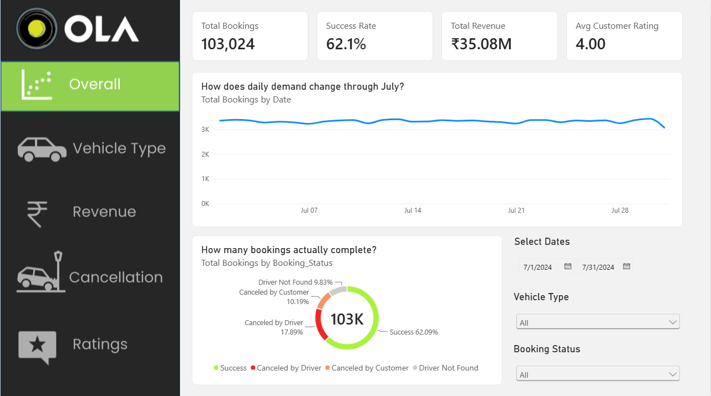
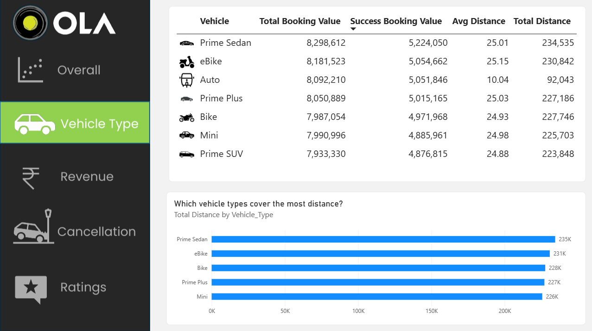
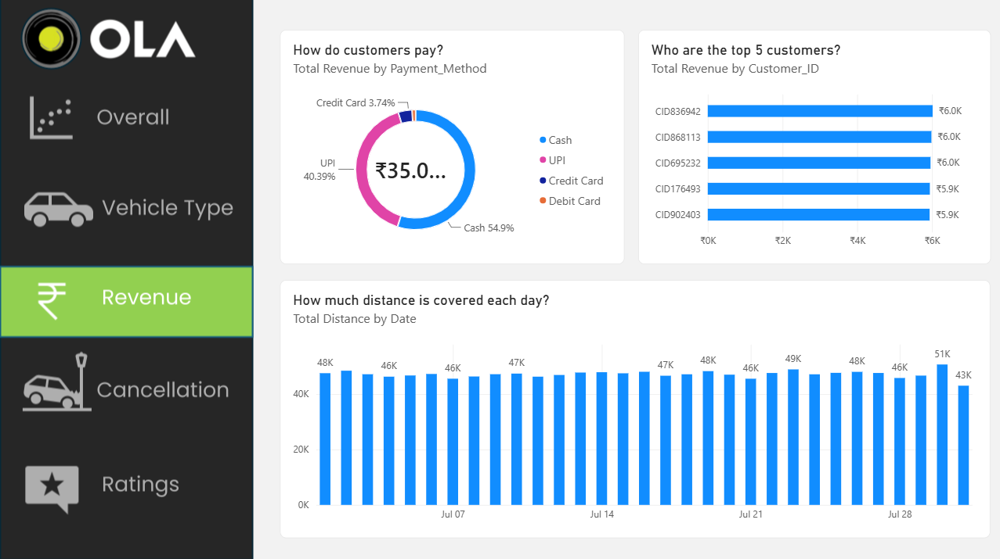
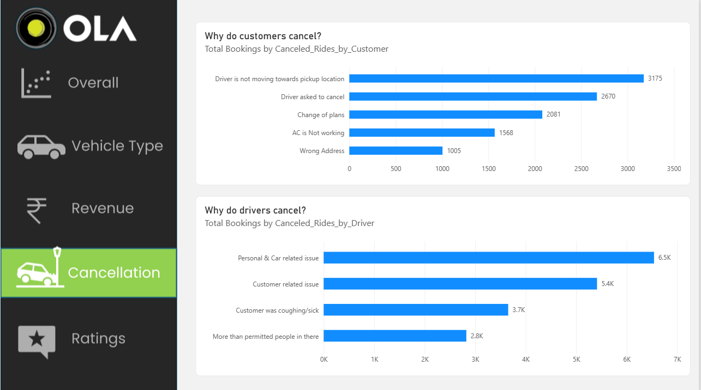
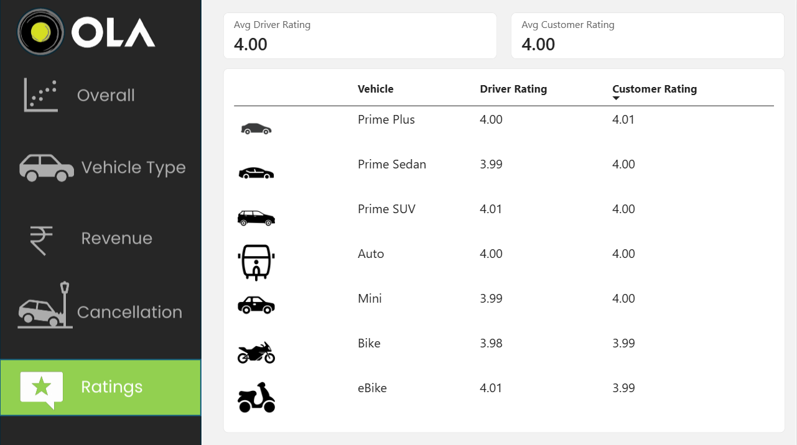

# Ola Ride Insights

**SQL + Power BI + Streamlit | Labmentix Internship, Project 3 (Business Analytics)**

An end-to-end analysis of one month (July 2024) of Ola ride bookings: data cleaning and EDA in Python, ten business queries in SQLite, a five-page Power BI dashboard, and a deployed Streamlit web app.

## Live App

**https://ola-ride-insights-stuti.streamlit.app/**

(Free Streamlit apps sleep after inactivity. If you see a "wake up" button, click it and wait a few seconds.)

## Full Documentation

Methodology, data cleaning decisions, detailed findings, recommendations, challenges and solutions are in [`docs/Ola_Ride_Insights_Documentation.pdf`](docs/Ola_Ride_Insights_Documentation.pdf).

---

## Project Overview

The project answers four questions: how many bookings succeed, why the rest fail, where revenue comes from, and how customers and drivers rate the service. The same questions are answered in three layers: **SQL** (queries), **Power BI** (visual storytelling) and **Streamlit** (an interactive, deployed app).

## Dataset

| Item | Value |
|---|---|
| Source | `data/OLA_DataSet.xlsx` (provided with the project brief) |
| Records | 103,024 bookings, all Booking_IDs unique |
| Period | July 2024 |
| Vehicle types | Prime Sedan, Prime SUV, Prime Plus, Mini, Auto, Bike, eBike |
| Payment methods | Cash, UPI, Credit Card, Debit Card |
| Unique customers | 94,544 |
| Pickup locations | 50 |

Revenue, distance and rating metrics use **successful** rides only. Incomplete rides are a subset of successful rides.

## Tech Stack

Python 3.11 (pandas, NumPy, matplotlib, seaborn) · Jupyter in VS Code · SQLite · Power BI Desktop (DAX) · Streamlit · Git and GitHub

## Repository Structure

```
Project-3/
├── app/
│   ├── app.py                  # Streamlit app (single file)
│   └── requirements.txt        # minimal dependencies for deployment
├── data/
│   ├── OLA_DataSet.xlsx        # raw dataset
│   ├── ola_cleaned.csv         # cleaned dataset
│   └── ola.db                  # SQLite database (table: ola_rides)
├── docs/
│   └── Ola_Ride_Insights_Documentation.pdf
├── notebooks/
│   └── cleaning_eda.ipynb      # cleaning + EDA with Markdown explanations
├── powerbi/
│   ├── ola_dashboard.pbix      # Power BI report
│   └── screenshots/            # one image per dashboard page
├── sql/
│   ├── load_db.py              # builds data/ola.db from the cleaned CSV
│   └── queries.sql             # the 10 business queries
├── README.md
└── requirements.txt            # full project dependencies
```

## SQL Queries and Results

All queries are in [`sql/queries.sql`](sql/queries.sql) and run live in the Streamlit app.

| # | Question | Result |
|---|---|---|
| 1 | Retrieve all successful bookings | 63,967 rows |
| 2 | Average ride distance for each vehicle type | eBike 25.15, Prime Plus 25.03, Prime Sedan 25.01, Mini 24.98, Bike 24.93, Prime SUV 24.88, Auto 10.04 (km) |
| 3 | Total rides cancelled by customers | 10,499 |
| 4 | Top 5 customers by number of rides | CID954071 (5 rides), then four customers with 4 rides each |
| 5 | Rides cancelled by drivers for personal and car related issues | 6,542 |
| 6 | Max and min driver ratings for Prime Sedan | 5.0 and 3.0 |
| 7 | All rides paid via UPI | 25,881 rows |
| 8 | Average customer rating per vehicle type | 3.99 to 4.01 for every type |
| 9 | Total booking value of successful rides | Rs. 35,080,467 |
| 10 | Incomplete rides with reasons | 3,926 rows: Customer Demand 1,601, Vehicle Breakdown 1,591, Other Issue 734 |

## Power BI Dashboard

A five-page interactive report (`powerbi/ola_dashboard.pbix`) with navigation buttons, synced slicers and DAX measures, styled on the supplied Ola template.

**Overall**


**Vehicle Type**


**Revenue**


**Cancellation**


**Ratings**


## Streamlit App

| Page | What it offers |
|---|---|
| Overview | KPI cards and charts for status, vehicle type, payment revenue, time of day, daily trend and cancellation reasons |
| SQL Query Explorer | Choose any of the ten queries, view the SQL and result, search inside the result, download as CSV, or run your own read-only SELECT |
| Data Explorer | Full table with search by Booking ID, Customer ID or location |
| Power BI Dashboard | The five dashboard pages as tabs |

Sidebar filters: date range, vehicle type, booking status and payment method.

## Key Insights

- **Total bookings:** 103,024. **Successful:** 63,967 (62.1%). **Revenue from successful rides:** Rs. 35,080,467.
- **About 38% of bookings fail.** Drivers cancel 17.9%, customers 10.2%, and 9.8% end with no driver found. The problem is mainly on the supply side.
- **Customer cancellations are mostly driver-caused:** "Driver is not moving towards pickup location" (3,175) and "Driver asked to cancel" (2,670) lead.
- **Top driver cancellation reason:** "Personal and car related issue" (6,542).
- **Revenue is evenly spread across vehicle types** (Rs. 4.88 to 5.22 million each). Auto rides are much shorter (about 10 km against about 25 km) but earn similar revenue.
- **Cash (54.8%) and UPI (40.5%)** dominate payments; cards are under 5%.
- **Ratings are about 4.0** for every vehicle type, and repeat usage is low (94,544 unique customers across 103,024 bookings).

## How to Run Locally

Windows PowerShell:

```powershell
# 1. Clone the repository and open the project folder
git clone https://github.com/stutigoyal8999/Labmentix_Internship_Business-Analytics.git
cd Labmentix_Internship_Business-Analytics\Project-3

# 2. Install dependencies
pip install -r requirements.txt

# 3. (Optional) Rebuild the SQLite database from the cleaned CSV
python sql\load_db.py

# 4. Run the Streamlit app
python -m streamlit run app\app.py
```

The app opens at `http://localhost:8501`. Open `notebooks/cleaning_eda.ipynb` in VS Code or Jupyter for the analysis, and `powerbi/ola_dashboard.pbix` in Power BI Desktop for the dashboard.

## Author

Stuti Goyal

